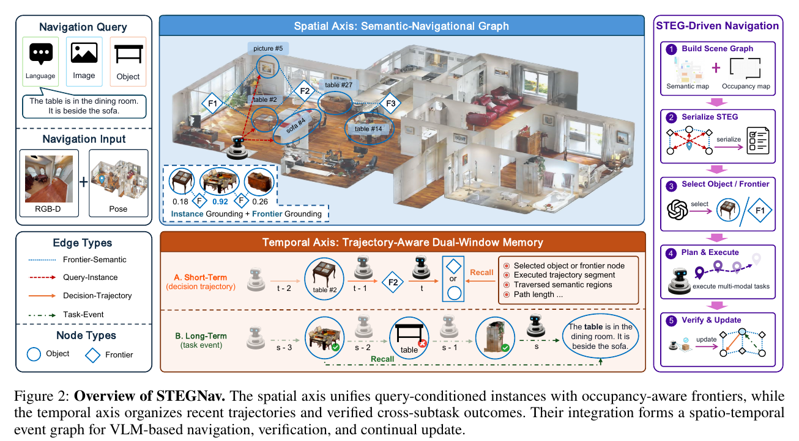
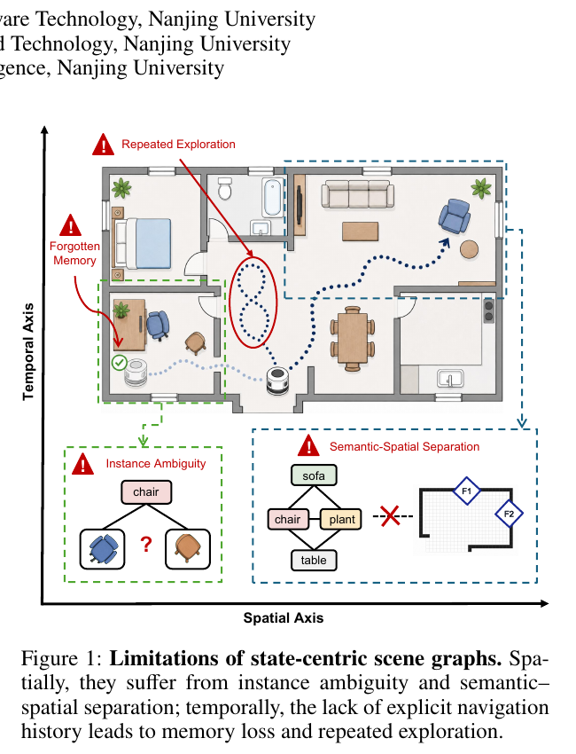
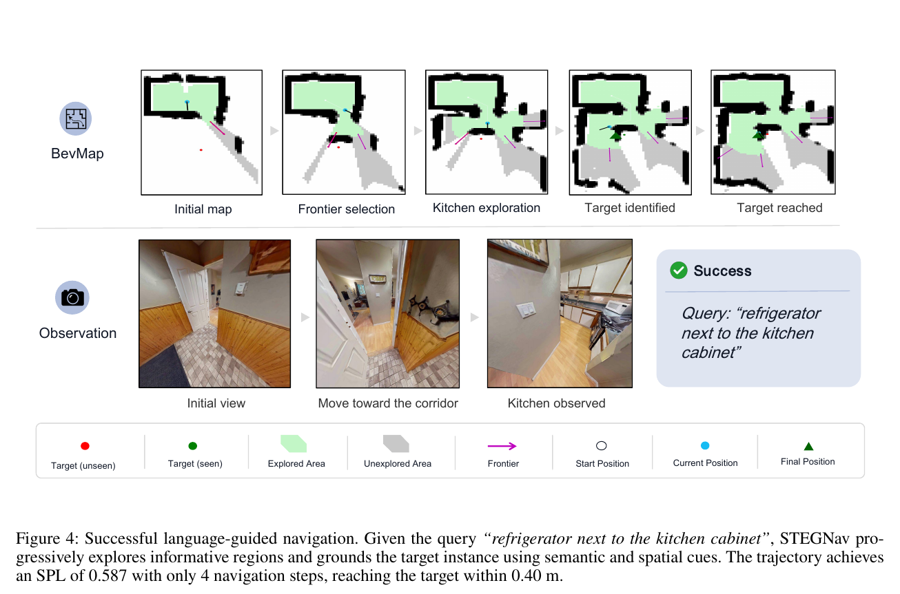
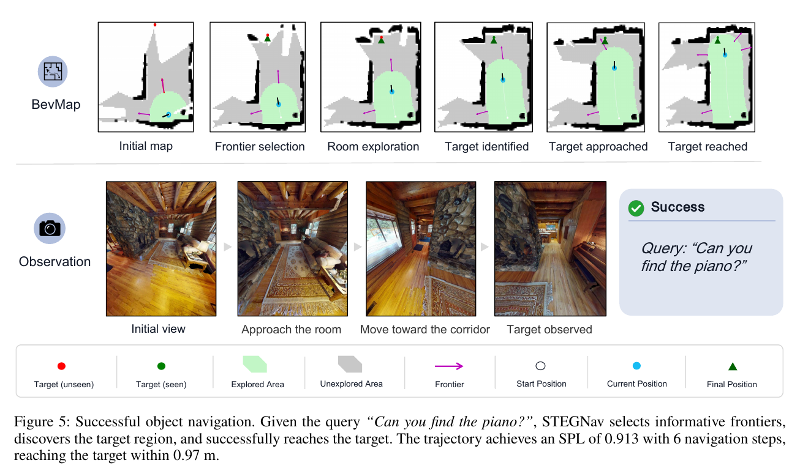
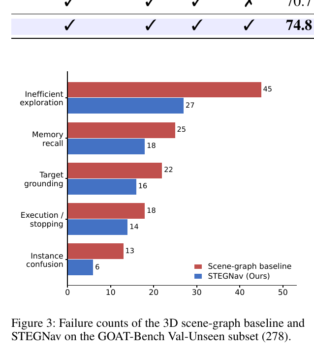

# STEGNav × HomeGraph Reproduction



*Figure 2 from the STEGNav paper: query-conditioned instances and frontiers form the spatial axis, while short- and long-term event memory form the temporal axis.*

> **Unofficial, paper-inspired reproduction.** This repository is not the
> official STEGNav implementation and is not affiliated with the paper's
> authors. It provides a transparent engineering scaffold based on the ideas
> described in [STEGNav (arXiv:2608.28279)](https://arxiv.org/abs/2608.28279).

[](https://github.com/yytgyutt/Stegnav/actions/workflows/test.yml)
[](LICENSE)

这个项目把 STEGNav 的论文思路拆成一套可运行、可替换的最小系统，并展示如何在现有 HomeGraph 上增加：

- **任务相关图构建**：不把整张固定图全部交给决策器，而是围绕当前指令筛选对象、房间和未知前沿。
- **未知区域探索**：当已知 HomeGraph 没有目标时，给候选 frontier 排序并选择下一处探索位置。
- **事件化记忆**：保存“为什么选择、执行结果、是否验证”，而不只是保存最终坐标。
- **验证后回写**：探索确认的新实例可以提升为长期记忆，并回写 HomeGraph。

## 它和现有 HomeGraph 的关系

HomeGraph 继续承担**长期、稳定、可编辑的世界模型**；本仓库在它上方增加一个面向当前任务的动态层：



*Figure 1 from the paper: a fixed state-centric graph can suffer from instance ambiguity, semantic-spatial separation, forgotten history and repeated exploration.*

## 论文中的运行示例



*Figure 4 from the paper: the agent explores frontiers and grounds “refrigerator next to the kitchen cabinet” in four navigation steps.*



*Figure 5 from the paper: the agent incrementally explores unknown regions and finds the piano.*

## 论文报告的失败数变化



*Figure 3 from the paper: compared with the controlled 3D scene-graph baseline, STEGNav reduces failures in inefficient exploration, memory recall, target grounding and instance confusion.*

> Figures 1–5 are reproduced from the cited arXiv paper for scholarly commentary and method explanation. Copyright remains with the paper authors; they are not covered by this repository's MIT license.

## 当前实现

| 论文概念 | 本仓库模块 | 当前状态 |
|---|---|---|
| Query grounding | `query_grounding.py` | 可运行的确定性基线 |
| Frontier grounding | `frontier_grounding.py` | 可运行的效用排序基线 |
| Spatio-temporal event graph | `event_graph.py` | 可序列化上下文图 |
| Short/long-term memory | `memory.py` | 有界短期记忆与验证提升 |
| Policy loop | `pipeline.py` | 选择—执行—验证—更新闭环 |
| HomeGraph integration | `homegraph_adapter.py` | 宽松 JSON 适配与增量回写 |

这不是对论文数值结果的复现，也没有声称使用作者未公开的训练代码、权重或数据。

## 快速开始

```bash
python3 -m venv .venv
source .venv/bin/activate
pip install -e '.[dev]'
pytest
stegnav-demo
```

不安装也可以直接运行：

```bash
PYTHONPATH=src python3 -m stegnav_reproduction.demo
```

## 接入你的 HomeGraph

```python
import json

from stegnav_reproduction.homegraph_adapter import HomeGraphAdapter

with open("homegraph.json", "r", encoding="utf-8") as handle:
    document = json.load(handle)

adapter = HomeGraphAdapter(document)
scene_nodes = adapter.scene_nodes()

# 探索并验证新实例后：
adapter.upsert_verified_object(
    node_id="lamp_new_01",
    label="floor_lamp",
    room_id="living_room",
    x=3.2,
    y=1.8,
    confidence=0.91,
)
```

不同 HomeGraph 版本字段可能不同，适配器会尽量保留原字段；正式接入前仍应使用你项目自身的 Schema 校验器。

## 下一步

1. 用真实 VLM/文本编码器替换当前确定性相似度基线。
2. 从 SLAM/ESDF 提取 frontier、可达性和路径代价。
3. 接入 Nav3 的导航、观测和恢复执行器。
4. 把验证的新实例以增量方式写回 HomeGraph，而不是覆盖人工标注字段。
5. 在家庭长程任务上建立成功率、探索距离、误更新率和记忆命中率评测。

详见 [架构说明](docs/architecture.md) 和 [HomeGraph 示例](examples/homegraph_adapter_example.py)。

## License

[MIT](LICENSE)
